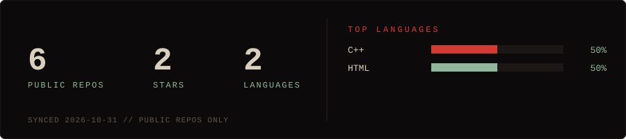

  

  

Indie game developer and Computer Science undergraduate at the **Institute of Space Technology (IST)**. I like building things from scratch: raycasting engines, multiplayer networking, and games with a bit of dread in them.

 

| File | Project | Type | Brief |
|:---:|---|---|---|
| `001` | **Which Way, Good Sir?** *(Cartographers)* | 🎮 Game Multiplayer | 5–15 player social-deduction dungeon-escape game in **Godot 4**. Procedural dungeon generation from a shared seed, fuel-based blind navigation, minimap rendering, asymmetric roles (Explorer / Cartographer / Mimic), and peer-to-peer multiplayer on Epic Online Services. |
| `002` | **[Blood Sector](https://github.com/abduhoo-bin-nasir/Blood-Sector)** *(ShadowBreach)* | 🎮 Game Horror FPS | Doom-style raycasting survival horror in plain **C++** with Raylib and no game engine. Full OOP hierarchy, abstract `Entity` base class, enemy AI variants, level and sound management. |
| `003` | **Ustad-e-Karigar** | 🤖 AI app Hackathon | AI assistant built on speech-to-text and language-model backends. **Regional Finalist**, Alibaba Cloud AI Hackathon Pakistan 2026 (Open Innovation track). |
| `004` | **RSVP Speed Reader** | 📱 Android app | Kotlin + Jetpack Compose app that ingests PDFs/EPUBs and displays text word by word. First mobile dev project. |
| `005` | **Takeaway** | 🌐 Web app | Full-stack food ordering web app: PHP/MySQL backend, admin panel, normalized schema, JOIN-heavy queries. |

 

- 🗺️ Developing **Which Way, Good Sir?**, with multiplayer networking on Epic Online Services P2P
- 🇩🇪 Studying German, working toward B2

 

  
  
  
  
  
  
  
  

  
  
  
  
  
  
  

 

 

  
  
  

