

  

  

Indie game developer and Computer Science undergraduate at the **Institute of Space Technology (IST)**. I like building things from scratch: raycasting engines, offline AI pipelines, and games with a bit of dread in them.

  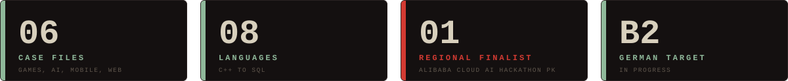

 

  <a href="https://github.com/abduhoo-bin-nasir/watch-man"></a>
  
  <a href="https://github.com/abduhoo-bin-nasir/Blood-Sector"></a>
  
  
  

 



 


 

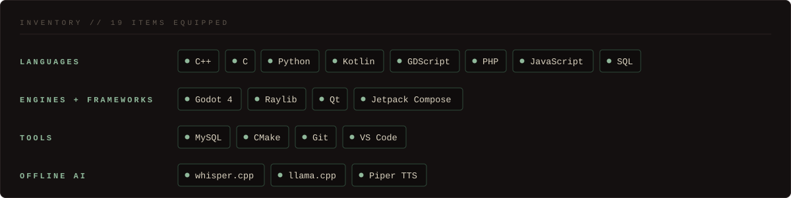

 

 

  <a href="https://abduhoo-bin-nasir.github.io">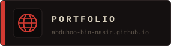</a>
  <a href="https://github.com/abduhoo-bin-nasir">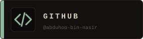</a>
  <a href="https://www.linkedin.com/in/abduhoo-bin-nasir/">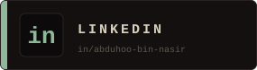</a>
  <a href="mailto:abduhoobinnasir@gmail.com">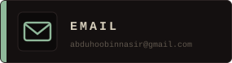</a>

